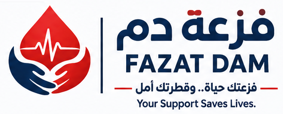

# فزعة دم — FAZAT DAM

**فزعتك حياة.. وقطرتك أمل · Your Support Saves Lives.**

A bilingual (Arabic-first, RTL) Progressive Web App that connects voluntary blood donors with patients and families, through two separate networks: **Sudan** and **Saudi Arabia**. It is a humanitarian community network, **not a medical service provider**.



## Status

| Area | State |
|---|---|
| Planning documents (PRD, journeys, schema, architecture, screens, design system, access matrix, roadmap) | Done, in `docs/` |
| Database: 26 tables, RLS on every table, workflow functions, audit log, storage policies | Done, in `supabase/migrations` |
| Database security and workflow tests | **98 checks passing** (`supabase/tests/run.sh`) |
| Next.js app: every Phase 1 screen, plus institutions, initiatives, sponsors and the admin dashboard | Built. Type-checks, lints and passes a production build |
| End-to-end run against a live Supabase project | **Not done yet.** Needs a Supabase project (see Setup) |
| Phone OTP | Needs an SMS provider configured in Supabase Auth |
| Web Push | Needs VAPID keys (otherwise in-app notifications only) |
| Maps | Not built (Phase 2) |
| Legal review (Saudi PDPL, healthcare rules, Sudanese law) | **Required before public launch.** Privacy and terms pages are marked as drafts |

## How it protects people

- **Phone numbers stay private.** Each donor appears only as an alias, e.g. `D-7K3QX`. A number is shown only when **both** sides approve contact for one specific request. Every reveal is audit-logged. Contact closes when the request is closed.
- **Networks never cross.** Donors are matched only to requests in their own country. This is enforced in the database: there is a composite city/country foreign key, and the matching functions check the country.
- **No medical claims.** Matching is preliminary (same city, same declared blood group, available). Eligibility and compatibility are decided by the blood bank. A donation counts as *confirmed* only after a facility or admin confirms it.
- **Moderation first.** Requests are reviewed before donors are contacted. Initiatives, institutions and sponsors are hidden until an admin approves them. Public pages read from column-limited views only.
- **Every state change goes through a database function** that re-checks the caller's role. RLS is the backstop.

## Stack

- Next.js 16 (App Router, TypeScript, server actions) with Tailwind CSS v4.
- Supabase: Postgres, Auth (phone OTP), private Storage, pg_cron.
- Web Push through `web-push`. A service worker handles offline mode.
- Fonts are self-hosted: IBM Plex Sans Arabic and Inter.

## Setup

1. **Create a Supabase project.** Then apply the migrations in order: `supabase db push`, or paste each file from `supabase/migrations/` into the SQL editor.
2. **Set up phone sign-in.** In Auth → Providers, enable **Phone** and connect an SMS provider (Twilio, MessageBird, Vonage…). For testing, add *test phone numbers* with fixed OTPs.
3. **Create the env file.** Copy `.env.example` to `.env.local` and fill in the Supabase URL and anon key.
   - `SUPABASE_SERVICE_ROLE_KEY` is optional. It is used for account deletion and push.
   - VAPID keys are optional: `npx web-push generate-vapid-keys`.
4. **Run the app.** Run `npm install` and then `npm run dev`.
5. **Make yourself admin.** Sign in once, then run in the SQL editor:
   ```sql
   insert into public.user_roles (user_id, role)
   select id, 'admin' from public.profiles where phone = '9665XXXXXXXX';
   ```
6. **Optional push dispatch.** Add a Database Webhook on `notifications` INSERT that sends a POST to `/api/push/dispatch` with `Authorization: Bearer $PUSH_DISPATCH_SECRET`. Server actions also dispatch on a best-effort basis.

### Database tests (no Docker needed)

```bash
PGHOST=... PGPORT=5432 PGUSER=postgres ./supabase/tests/run.sh   # creates a throwaway DB and runs 98 checks
```

## Structure

```
docs/                    planning documents + brand reference sheet
supabase/migrations/     0001 schema · 0002 security/RLS · 0003 workflows · 0004 reference data · 0005 storage & cron
supabase/tests/          platform stub + end-to-end security/workflow tests
public/brand, icons      logo variants (cropped from the official logo sheet), PWA icons
public/sw.js             service worker
src/app/                 screens (see docs/05-screen-inventory.md) and server actions
src/lib/                 Supabase clients, auth, i18n dictionaries (ar/en), push, helpers
```

## Test data

There is no fabricated data in the app or the migrations. Any demonstration rows must set `is_demo = true`. These rows show a **"بيانات تجريبية / Demo data"** badge and are left out of public statistics. See `docs/09-test-data-policy.md`.

> Brand note: the logo files are PNG crops of the official logo sheet (`docs/brand/logo-concept-sheet.png`). Ask the designer for vector (SVG/AI) masters before using them in print.

## Third-party

- Fonts: El Messiri and Inter via Fontsource (SIL Open Font License).
