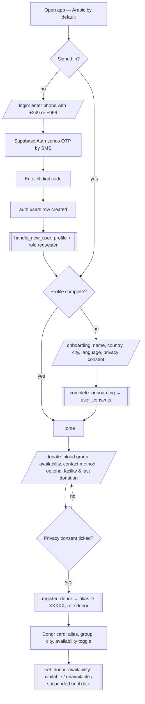
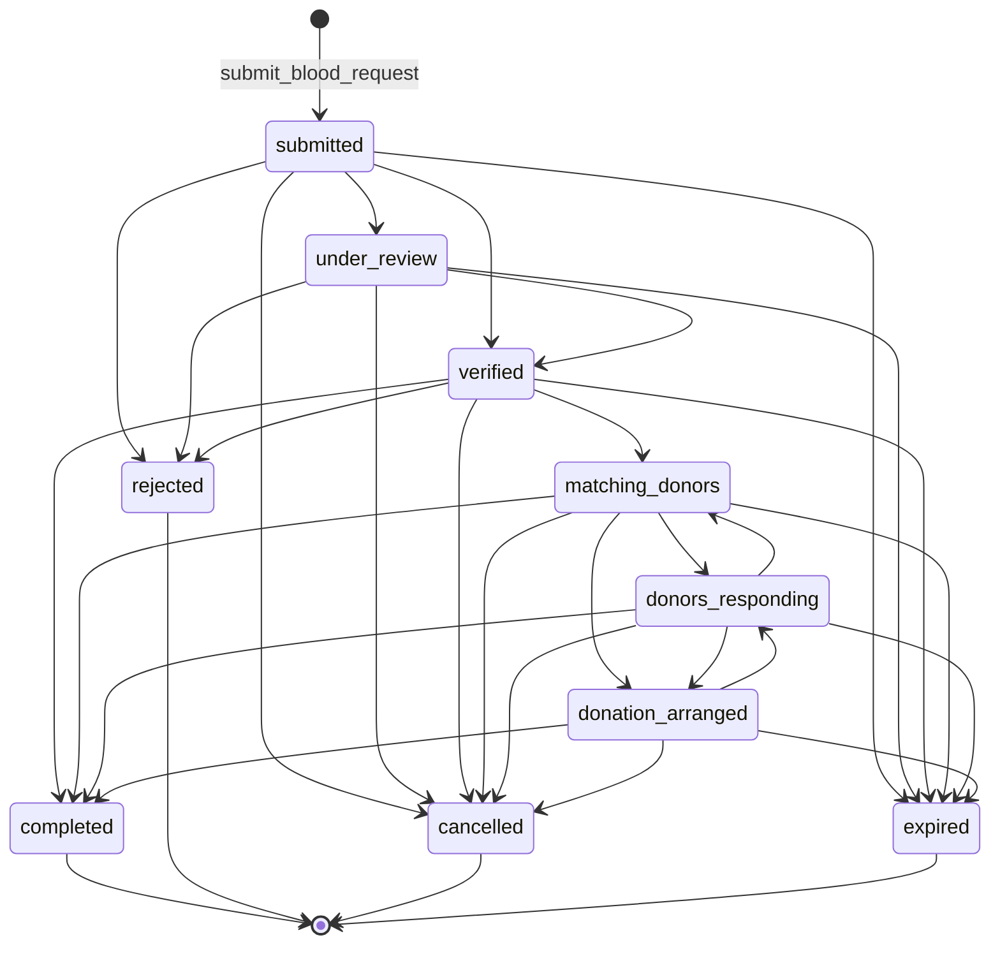
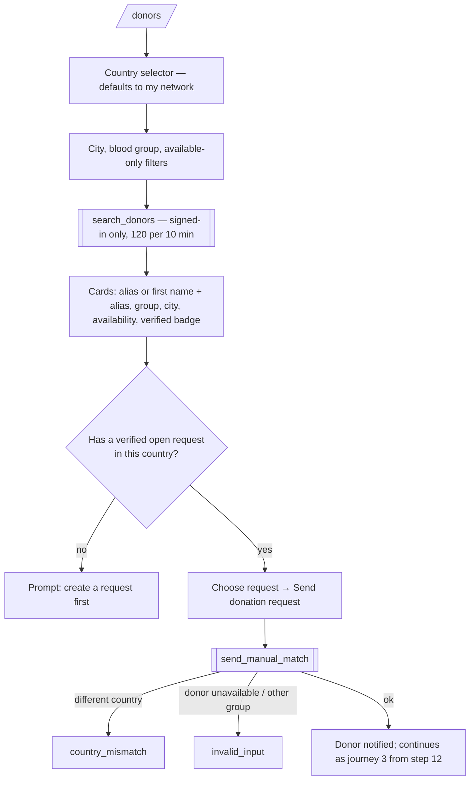
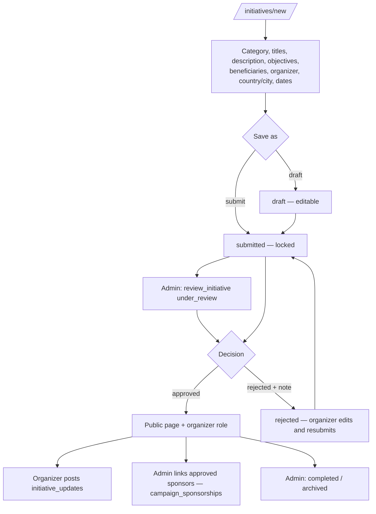
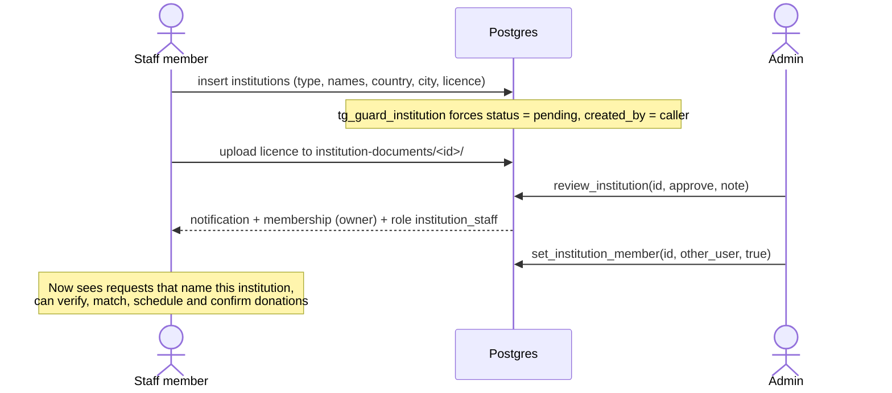

# User journeys

All diagrams use the real function names and statuses from `supabase/migrations`.

## 1. Sign-up and donor registration



## 2. Request status lifecycle

Exactly the transitions allowed by `public._allowed_transition`. `matching_donors` and `donors_responding` are also set automatically by `run_auto_matching`, `send_manual_match` and `respond_to_match`; `donation_arranged` by `schedule_appointment`; `expired` by `expire_overdue_requests` (pg_cron every 15 min).



Who may move it:

| Target | Allowed caller |
|---|---|
| `cancelled` | the requester, or a reviewer (admin / staff of the named institution) |
| `expired` | admin, or the scheduled job |
| anything else | reviewer only; `rejected` needs a note |

On a terminal status, pending matches are closed and donors who were still waiting get a notification.

## 3. Emergency request → matching → donation

```mermaid
sequenceDiagram
  autonumber
  actor R as Requester
  participant App as PWA
  participant DB as Postgres (RPC + RLS)
  actor S as Staff / Admin
  actor D as Donor

  R->>App: Fill request form (+ declaration)
  App->>DB: submit_blood_request(...)
  DB-->>R: reference FD-SA-YYMM-XXXXX, status submitted
  DB-->>S: notification "request_needs_review" (institution staff)
  R->>App: Upload documents (private bucket)
  S->>DB: transition_request(id, 'under_review')
  S->>DB: transition_request(id, 'verified', note)
  DB-->>R: notification: verified
  S->>DB: run_auto_matching(id)
  Note over DB: same country + same city + same declared group<br/>+ available + accepts_auto_matching<br/>+ not blocked + not already matched (max 25)
  DB-->>D: notification "match_request" (eligibility decided by blood bank)
  DB-->>R: "matching_started", N donors notified
  D->>DB: respond_to_match(match, accept=true, share_contact?)
  DB-->>R: "donor_accepted"; status donors_responding
  R->>DB: set_contact_consent(match, true)
  D->>DB: set_contact_consent(match, true)
  DB-->>R: "contact_shared"
  R->>DB: get_match_contact(match)
  DB-->>R: donor name, phone, preferred method (audited)
  R->>DB: schedule_appointment(match, time, note)
  DB-->>D: "appointment" with hospital
  Note over D,S: Screening, grouping, crossmatch happen at the facility
  D->>DB: record_donation(match, date) → pending_confirmation
  S->>DB: confirm_donation(record, true)
  DB-->>D: "donation_confirmed"; donor is_verified = true
  S->>DB: transition_request(id, 'completed')
```

A donor may decline (`respond_to_match(..., false)`) or later withdraw an acceptance. Either side may withdraw contact consent; contacts disappear again. A block between the two hides contact and stops messaging.

## 4. Manual search



Requesters may only send to the **same blood group** and are limited to 20 manual requests per day. Staff and admins may choose any group.

## 5. Humanitarian initiative



Expatriates in Saudi Arabia support Sudan through these initiatives — never through direct donor matching to a request in Sudan.

## 6. Institution onboarding


