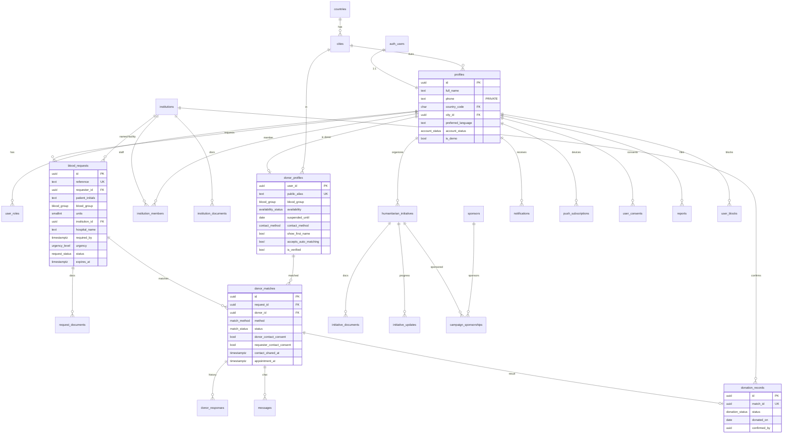

# Database schema

PostgreSQL 17 on Supabase. Source of truth: `supabase/migrations/`.

| Order | File | Contents |
|---|---|---|
| 1 | `20261107000001_core_schema.sql` | Enums, tables, constraints, indexes, `updated_at` triggers, `hospitals` / `blood_banks` views |
| 2 | `20261107000002_security.sql` | Role helpers, new-user bootstrap, column guards, audit triggers, RLS policies, grants |
| 3 | `20261107000003_workflows.sql` | Workflow RPCs (requests, matching, consent, donations, admin, stats, account) |
| 4 | `20261107000004_reference_data.sql` | Countries SD/SA, cities, default `app_settings` |
| 5 | `20261107000005_storage_and_jobs.sql` | Storage buckets + policies, pg_cron jobs (Supabase only) |

Conventions: UUID primary keys (`gen_random_uuid()`), except `countries.code` (ISO alpha-2 natural key) and the composite key of `user_blocks`; every table has `created_at` and `updated_at`; every location uses the composite FK `(city_id, country_code) → cities(id, country_code)`, so a city can never belong to the wrong network.

## ER diagram



Internal tables not drawn: `audit_logs`, `rate_limit_events`, `app_settings`.

## Enums

| Enum | Values |
|---|---|
| `app_role` | donor, requester, institution_staff, organizer, admin |
| `blood_group` | A+, A-, B+, B-, AB+, AB-, O+, O- |
| `availability_status` | available, unavailable, temporarily_suspended |
| `contact_method` | in_app, phone_call, whatsapp, sms |
| `account_status` | active, suspended, deleted |
| `request_status` | submitted, under_review, verified, matching_donors, donors_responding, donation_arranged, completed, rejected, cancelled, expired |
| `urgency_level` | normal, urgent, critical |
| `match_method` | automated, manual |
| `match_status` | pending, accepted, declined, withdrawn, cancelled, expired |
| `donation_status` | pending_confirmation, confirmed, not_completed |
| `institution_type` | hospital, blood_bank |
| `approval_status` | pending, approved, rejected, suspended |
| `initiative_status` | draft, submitted, under_review, approved, rejected, completed, archived |
| `initiative_category` | blood_drive, medical_support, hospital_assistance, volunteer, awareness, partnership |
| `sponsor_type` | corporate, community, hospital, blood_bank, humanitarian_org |
| `consent_type` | privacy_policy, terms_of_use, data_processing, contact_sharing, push_notifications, request_declaration |
| `report_target` | user, blood_request, initiative, message, institution |
| `report_status` | open, reviewing, resolved, dismissed |

## Tables

| Table | Purpose | Notes |
|---|---|---|
| `countries` | The two networks (SD +249, SA +966) | Admin-managed; public read of active rows |
| `cities` | Configurable cities per country | `unique(id, country_code)` backs the composite FKs |
| `profiles` | One row per auth user | `phone` copied from verified auth phone; readable only by self and admins |
| `user_roles` | Role grants | Written by workflows and admins only |
| `donor_profiles` | Donor card | `public_alias` shown instead of a name; `is_verified` only after a confirmed donation |
| `institutions` | Hospitals and blood banks (typed) | Created `pending`; views `hospitals`, `blood_banks` (security_invoker) |
| `institution_members` | Staff of an institution | Active members of approved institutions act as reviewers |
| `institution_documents` | Licence/registration files metadata | File in private bucket |
| `blood_requests` | Emergency requests | Patient initials only; `declaration_accepted` must be true; `expires_at` = needed-by + 24 h |
| `request_documents` | Supporting documents metadata | PDF/JPEG/PNG/WebP, ≤ 10 MB |
| `donor_matches` | Request ↔ donor link | Unique per (request, donor); consent flags; appointment |
| `donor_responses` | History of accept/decline/withdraw | Append-only |
| `messages` | In-app chat per match | Only after mutual consent, accepted match, no block |
| `donation_records` | Donation outcome | `confirmed` requires `confirmed_by` + `confirmed_at` (check constraint) |
| `humanitarian_initiatives` | Campaigns | Public only when `approved` / `completed` |
| `initiative_documents`, `initiative_updates` | Proposal files; progress posts | Updates only while approved |
| `sponsors`, `campaign_sponsorships` | Partners and their link to initiatives | Public only when approved |
| `notifications` | In-app inbox, also drives Web Push | `pushed_at` marks push delivery; links are in-app paths only |
| `push_subscriptions` | Web Push endpoints | Owner only |
| `user_consents` | Consent ledger (append-only) | With policy version and context |
| `reports`, `user_blocks` | Moderation | |
| `audit_logs` | Who changed what | Admin read only; PII stripped |
| `rate_limit_events` | Sliding-window counters | No API access; pruned nightly |
| `app_settings` | `matching.batch_size`, `requests.max_open_per_user`, `requests.max_per_day`, `requests.grace_hours`, `privacy.policy_version` | |

## Privacy design

- **Row Level Security is on for every table.** Nobody but the owner and admins can select a `profiles` or `donor_profiles` row.
- **Strangers see projections, not rows.** `search_donors`, `public_emergency_requests`, `my_donation_requests`, `request_matches` and `public_stats` are `SECURITY DEFINER` functions returning only safe columns (alias, group, city, availability, verified flag).
- **Phone numbers** leave the database only through `get_match_contact`, which requires an `accepted` match with `contact_shared_at` set (both consent flags true), no block, and writes a `contact_revealed` audit row.
- **Audit triggers** (`tg_audit`) strip `phone, email, full_name, contact_phone, contact_email, organizer_contact, body, p256dh, auth` before storing.
- **Column guards** (`tg_guard_*`, security invoker) stop API callers from changing moderation fields (`account_status`, `status`, `is_verified`, `public_alias`, `is_demo`, …) even on rows they may update. Trusted workflow functions run as the table owner and pass.
- **Account deletion** (`delete_my_account`) cancels open requests, withdraws matches, removes the donor profile and push subscriptions, and blanks name/phone/email; the server then deletes the auth user.

## RPC catalogue

Error codes raised: `not_authenticated`, `not_authorized`, `account_inactive`, `rate_limited`, `not_found`, `invalid_input`, `invalid_transition`, `country_mismatch`, `consent_required`, `too_many_open_requests`, `blocked`.

| Function | Caller | Does |
|---|---|---|
| `complete_onboarding(name, country, city, lang, accept)` | signed-in | Saves profile basics, records privacy + data-processing consent |
| `register_donor(...)` | signed-in | Creates/updates donor profile, alias `D-XXXXX`, grants `donor` |
| `set_donor_availability(status, until)` | donor | Available / unavailable / suspended until date (≤ 1 year) |
| `search_donors(country, city, group, available_only, limit, offset)` | signed-in | Anonymised directory, max 50 rows, 120 calls / 10 min |
| `public_emergency_requests(country, limit)` | anyone | Verified open requests, no patient data |
| `public_stats(country)` | anyone | Real counts, demo rows excluded |
| `submit_blood_request(...)` | signed-in | Validates, caps (3 open, 5/day), reference, notifies institution staff |
| `transition_request(id, status, note)` | requester (cancel) / reviewer | The only status changer; enforces `_allowed_transition` |
| `expire_overdue_requests()` | pg_cron | Expires overdue requests and pending matches |
| `run_auto_matching(id, limit)` | reviewer | Inserts up to `batch_size` matches and notifies donors |
| `send_manual_match(request, donor)` | requester (same group, 20/day) / reviewer | One manual match, same country |
| `my_donation_requests()` | donor | Donor inbox with reduced request view |
| `request_matches(id)` | requester / reviewer | Matched donors as aliases with status and consent flags |
| `respond_to_match(match, accept, reason, share)` | matched donor | Accept / decline / withdraw |
| `set_contact_consent(match, consent)` | either party | Sets own flag; both true → `contact_shared_at` |
| `get_match_contact(match)` | either party after mutual consent | Other party's name, phone, method; audited |
| `schedule_appointment(match, at, note)` | requester / reviewer | Sets appointment, request → `donation_arranged` |
| `record_donation(match, date, units, notes)` | donor / requester (pending) / reviewer (confirmed) | Creates donation record |
| `confirm_donation(record, confirm, note)` | admin / staff of institution | Confirms or marks not completed; verifies donor |
| `review_institution(id, approve, note)` | admin | Approve/reject; owner becomes member + `institution_staff` |
| `set_institution_member(inst, user, active, title)` | admin | Add/remove staff |
| `review_initiative(id, status, note)` | admin | under_review / approved / rejected / completed / archived |
| `review_sponsor(id, approve, note)` | admin | Approve/reject sponsor |
| `admin_set_account_status(user, status, note)` | admin | Suspend/restore; withdraws pending matches |
| `admin_set_role(user, role, grant)` | admin | Grant/revoke role (cannot remove own admin) |
| `resolve_report(id, status, note)` | admin | Moderation outcome |
| `admin_broadcast(country, …)` | admin | Announcement notification to a network |
| `admin_stats(country, city, from, to, include_demo)` | admin | Dashboard JSON |
| `admin_find_user(query)` | admin | Search by phone digits, name or id |
| `mark_all_notifications_read()` | signed-in | |
| `delete_my_account()` | signed-in | Anonymise account (see above) |

Helpers used by policies: `has_role`, `is_admin`, `is_active_user`, `my_institution_ids`, `is_institution_member`, `can_review_request`, `is_blocked_between`, `is_match_party`, `can_message`. Internals (`_notify`, `_rate_limit`, `_record_consent`, `_after_donation_confirmed`, …) are not executable by API roles.

## Index rationale

| Index | Serves |
|---|---|
| `donor_profiles_match_idx (country, city, group, availability)` | Auto matching and search |
| `blood_requests_feed_idx (country, status, urgency, required_by)` | Public emergency feed |
| `blood_requests_city_idx`, `blood_requests_institution_idx` | Reviewer queues, stats by city |
| `blood_requests_expiry_idx` (partial, open only) | Expiry job |
| `donor_matches_donor_idx`, `donor_matches_request_idx` | Donor inbox, request page |
| `notifications_unread_idx` (partial), `notifications_push_idx` (partial) | Badge count, push dispatcher |
| `rate_limit_events_idx (user, action, created_at)` | Sliding-window checks |
| `audit_logs_*` | Admin audit filters |

## Running the tests

The tests run on plain PostgreSQL ≥ 15 with a small Supabase stub (`tests/00_supabase_stub.sql`: roles `anon`/`authenticated`/`service_role`, `auth.users`, `auth.uid()`).

```bash
export PGHOST=localhost PGPORT=5432 PGUSER=postgres
./supabase/tests/run.sh      # applies migrations 1-4 + 85 checks, ends with "ALL TESTS PASSED"
```

On a Supabase project apply all five migrations in order (`supabase db push`, or the SQL editor), then create the first admin:

```sql
insert into public.user_roles (user_id, role)
select id, 'admin' from public.profiles where phone = '9665XXXXXXXX';
```
