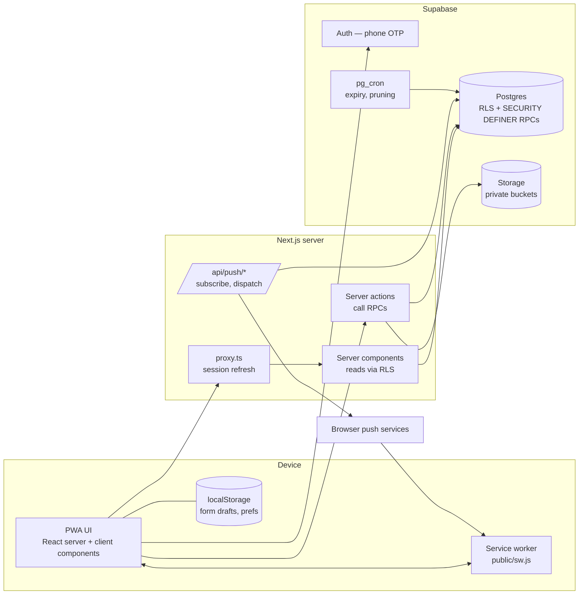

# Application architecture

## Stack

| Layer | Choice |
|---|---|
| Frontend | Next.js 16 (App Router), React 19, TypeScript |
| Styling | Tailwind CSS v4 with design tokens in `globals.css` |
| Auth | Supabase Auth, phone OTP (SMS provider configured in Supabase) |
| Data | Supabase PostgreSQL 17, Row Level Security, workflow RPCs |
| Files | Supabase Storage, private buckets, short-lived signed URLs |
| Push | Web Push (VAPID) via the `web-push` library |
| Fonts | IBM Plex Sans Arabic + Inter, self-hosted through `@fontsource` |
| Hosting | Any Node.js host with HTTPS (Vercel recommended) |

## Component diagram

## Request flow

1. `proxy.ts` runs on page requests, refreshes the Supabase session cookie (`@supabase/ssr`), and redirects signed-out users away from private routes. It does **not** make authorisation decisions; the database does.
2. **Reads**: server components create a per-request Supabase server client with the user's cookie. Queries run as `authenticated` (or `anon`), so RLS decides what comes back.
3. **Writes**: server actions call Postgres RPCs (`supabase.rpc(...)`). Every RPC is `SECURITY DEFINER` with a pinned `search_path`, checks `auth.uid()`, account status and role, and enforces the business rules (state machine, country separation, consent, rate limits). Tables that hold workflow state have no UPDATE policy at all, so the RPCs are the only path.
4. Errors come back as short codes (`not_authorized`, `rate_limited`, …) that the UI maps to translated messages.
5. RLS is the backstop: even a bug in the app cannot read another user's profile or a request it is not party to.

The service-role key is used only on the server for two jobs: deleting the auth user after `delete_my_account()` and the push dispatcher. It is never sent to the browser.

## Authentication

- `/login`: phone number with country prefix (+249 / +966) → `signInWithOtp({ phone })` → `verifyOtp({ phone, token, type: 'sms' })`.
- The `handle_new_user` trigger creates the profile and the `requester` role; `/onboarding` completes it.
- Supabase must have an SMS provider (Twilio, MessageBird, Vonage, or a hook to a local provider). For development, Supabase "test phone numbers" with fixed OTPs can be used.
- Suspended or deleted accounts are refused by every RPC (`account_inactive`).

## Storage

| Bucket | Visibility | Path | Who uploads / reads |
|---|---|---|---|
| `request-documents` | private | `<request_id>/<uuid>.<ext>` | requester while submitted/under review; requester + reviewers read |
| `initiative-documents` | private | `<initiative_id>/…` | organizer while draft/submitted/rejected; organizer + admin read |
| `institution-documents` | private | `<institution_id>/…` | creator; creator + admin read |
| `sponsor-logos` | public | `<sponsor_id>/…` | admin only |

Private files are served only through signed URLs that expire in minutes and are never cached by the service worker.

## Notifications and Web Push

- Every workflow event inserts into `notifications` (bilingual title/body, in-app link). The bell and `/notifications` read this table — this is the fallback that always works.
- When the user allows notifications, the browser subscription is stored in `push_subscriptions` (POST `/api/push/subscribe`) and a `push_notifications` consent is recorded.
- `/api/push/dispatch` (protected by `PUSH_DISPATCH_SECRET`, called after workflow actions and/or by a Supabase Database Webhook on `notifications` insert) sends unsent notifications (`pushed_at is null`) with `web-push`, sets `pushed_at`, and removes expired endpoints (HTTP 404/410).
- Push payloads contain only the title and an in-app link — no names, phone numbers or medical details.

## Service worker and offline

| Resource | Strategy |
|---|---|
| `/_next/static/*`, fonts, icons, `/brand/*` | Cache-first (immutable) |
| Page navigations | Network-first; on failure show the cached `/offline` page |
| `/api/*`, Supabase requests, auth callbacks, signed file URLs | Network only, never cached |
| HTML of private pages | Not cached |

The app shows an offline banner from `navigator.onLine`. The request form keeps a local draft and offers to submit it when the connection returns. Nothing sensitive is stored offline.

## Internationalisation

- One route tree, no `/ar` and `/en` duplicates.
- Language is stored in the `lang` cookie (default `ar`) and in `profiles.preferred_language`.
- The root layout sets `<html lang dir>` (`rtl` for Arabic, `ltr` for English).
- UI strings live in typed dictionaries (`ar`, `en`); data with two names (`cities.name_ar/name_en`, initiative titles) picks the matching column.
- Layout uses logical properties (`ms-*`, `me-*`, `ps-*`, `pe-*`, `start`, `end`) so it mirrors automatically.

## Deployment

Environment variables:

| Variable | Where | Purpose |
|---|---|---|
| `NEXT_PUBLIC_SUPABASE_URL` | public | Project URL |
| `NEXT_PUBLIC_SUPABASE_ANON_KEY` | public | Anon / publishable key (RLS applies) |
| `SUPABASE_SERVICE_ROLE_KEY` | server only | Auth user deletion, push dispatcher |
| `NEXT_PUBLIC_VAPID_PUBLIC_KEY` | public | Web Push subscription |
| `VAPID_PRIVATE_KEY` | server only | Signing push messages |
| `VAPID_SUBJECT` | server only | `mailto:` contact for push services |
| `PUSH_DISPATCH_SECRET` | server only | Protects `/api/push/dispatch` |

Steps:

1. Create the Supabase project (region chosen after the data-residency review).
2. Apply `supabase/migrations` in order. Migration 5 needs pg_cron (enable it in the dashboard); without it, call `expire_overdue_requests()` from an external scheduler.
3. Configure the SMS provider for phone auth; set the site URL.
4. Generate VAPID keys (`npx web-push generate-vapid-keys`).
5. Deploy the Next.js app with the variables above, HTTPS only.
6. Grant the first admin role in SQL (see [03-database-schema.md](03-database-schema.md)).

Scheduled jobs (migration 5):

| Job | Schedule | Action |
|---|---|---|
| `fazat-expire-requests` | every 15 min | `expire_overdue_requests()` |
| `fazat-prune-rate-limits` | daily 03:17 | delete rate-limit events older than 2 days |
