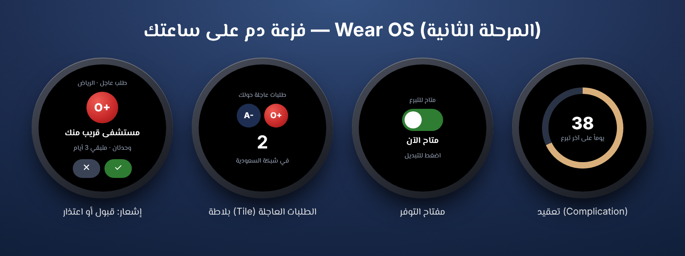

# فزعة دم على الساعة الذكية — الإمكانية والخطة

## ما يعمل اليوم دون أي تطوير ✅
إشعارات «فزعة دم» تنتقل تلقائياً إلى الساعة المقترنة بالجوال، سواء Wear OS مثل Galaxy Watch وPixel Watch، أو Apple Watch عبر Safari على iOS 16.4+ بعد إضافة الموقع للشاشة الرئيسية. فيصل للمتبرع تنبيه «طلب عاجل O+ في مدينتك» على معصمه من الآن.

## لماذا لا نرفع النسخة الحالية للساعة مباشرة؟
- التطبيق الحالي من نوع TWA، وهو يعرض الموقع داخل Chrome.
- لا يوجد Chrome ولا متصفح كامل على Wear OS، وشاشة الساعة الدائرية الصغيرة لا تناسب صفحات الويب.
- لذلك تحتاج الساعة **تطبيقاً أصلياً صغيراً** (Kotlin + Compose for Wear OS) يُرفع ضمن **نفس** صفحة المتجر وبنفس اسم الحزمة.

## ما تقدمه نسخة الساعة (المرحلة الثانية)

| الميزة | الوصف |
|---|---|
| إشعار تفاعلي | طلب عاجل بفصيلتك ومدينتك، مع زرّي **قبول ✓ / اعتذار ✕** دون فتح الجوال |
| بلاطة Tile | عدد الطلبات العاجلة الموثّقة في شبكتك الآن وفصائلها |
| مفتاح التوفر | «متاح للتبرع» تشغيل/إيقاف بلمسة |
| تعقيد Complication | عدّاد الأيام منذ آخر تبرع على وجه الساعة، ويتحوّل للأحمر عند اكتمال فترة الانتظار |

**ما لا تفعله الساعة عمداً:** لا تعرض أرقام هواتف ولا بيانات تواصل، لأن الكشف يبقى على الجوال حفاظاً على الخصوصية.

## التنفيذ التقني المقترح
- **التطبيق:** وحدة `wear/` بلغة Kotlin تستخدم Compose for Wear OS وTiles API وComplications Data Source API.
- **الدخول:** يتم عبر الجوال باستخدام Data Layer API، فالساعة لا تحتاج إدخال بريد.
- **الواجهات الخلفية:** نفس دوال Supabase الآمنة الموجودة (`respond_to_match`، `set_donor_availability`، `public_emergency_requests`)، فلا تغيير في قاعدة البيانات.
- **الإشعارات:** تُستقبل عبر Firebase Cloud Messaging. هذه هي الإضافة الوحيدة على الخادم.
- **التقدير:** من 3 إلى 4 أسابيع، تشمل التصميم الدائري ومراجعة متجر Wear OS.
- **Apple Watch:** يتطلب تطبيق iOS أصلياً أولاً، ويمكن ضمه لاحقاً للمرحلة الثالثة.
